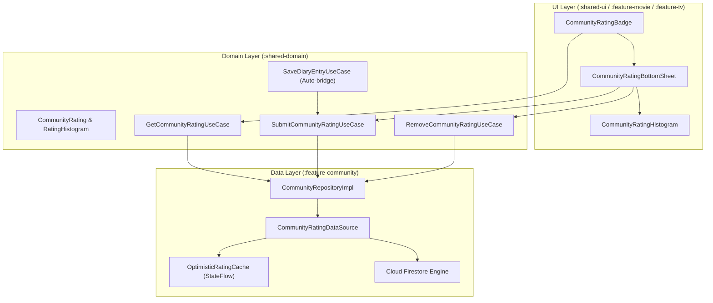

# ShowTime Community Rating & Histogram: Architecture & Technical Spec

## 1. Executive Summary & Vision

ShowTime's **Community Rating & Histogram** provides cinephiles with an independent, authentic community rating system operating on a **0.5 to 5.0 star scale** (10 half-step increments). Inspired by Letterboxd's iconic rating distribution histogram, it allows users to instantly visualize consensus versus polarization, submit ratings with **0ms optimistic latency**, and automatically bridge personal Cinema Diary logs to power community scores without manual survey friction.

```
┌──────────────────────────────────────────────────────────────────────────────────┐
│  🎯 STRATEGIC HIGHLIGHTS                                                         │
│  • 10-Point Scale: 0.5 to 5.0 stars matching Letterboxd & ShowTime Diary         │
│  • Dual-Score Progressive Display: TMDb anchor + ShowTime Community badge        │
│  • Diary Auto-Bridge: Every logged film/show organically feeds community stats   │
│  • 100% Free Infrastructure: O(1) single-document reads on Firebase Spark Plan   │
│  • Parity & Advantage: First-class ratings for Movies AND TV Shows/Episodes      │
└──────────────────────────────────────────────────────────────────────────────────┘
```

---

## 2. End-to-End System Architecture



---

## 3. Cloud Firestore Data Schema

### A. Global Media Rating Document
* **Path**: `/{prefix}media_ratings/{mediaType.toStorageKey()}_{mediaId}`
* **Example**: `/media_ratings/movie_550`

```json
{
  "ratingCount": 142,
  "ratingSum": 582.5,
  "averageRating": 4.10,
  "histogram": {
    "0.5": 2,
    "1.0": 1,
    "1.5": 0,
    "2.0": 5,
    "2.5": 11,
    "3.0": 22,
    "3.5": 36,
    "4.0": 39,
    "4.5": 20,
    "5.0": 6
  },
  "updatedAt": "Timestamp"
}
```

### B. Per-User Rating Document
* **Path**: `/{prefix}user_media_ratings/{firebaseUid}_{mediaType.toStorageKey()}_{mediaId}`
* **Example**: `/user_media_ratings/abc123firebaseUid_movie_550`
* **Privacy & Ownership**: Keyed strictly by Firebase Auth UID (zero email/PII stored). Enforced in `firestore.rules` with `allow list: if false` and per-UID `get`/`create`/`update`/`delete` coupled transactionally to `media_ratings`.

```json
{
  "firebaseUid": "abc123firebaseUid",
  "mediaId": 550,
  "mediaType": "movie",
  "rating": 4.5,
  "updatedAt": "Timestamp"
}
```

---

## 4. Atomic Transaction & Calculation Rules

When a user submits or updates their rating, Firestore executes a single atomic transaction:

1. **New Rating**:
   $$\text{ratingCount} \leftarrow \text{ratingCount} + 1$$
   $$\text{ratingSum} \leftarrow \text{ratingSum} + \text{newRating}$$
   $$\text{histogram}[\text{newRating}] \leftarrow \text{histogram}[\text{newRating}] + 1$$

2. **Updated Rating** (e.g., user changed $3.5\star \to 4.5\star$):
   $$\text{ratingSum} \leftarrow \text{ratingSum} + (\text{newRating} - \text{oldRating})$$
   $$\text{histogram}[\text{oldRating}] \leftarrow \text{histogram}[\text{oldRating}] - 1$$
   $$\text{histogram}[\text{newRating}] \leftarrow \text{histogram}[\text{newRating}] + 1$$

3. **Removed Rating**:
   $$\text{ratingCount} \leftarrow \max(0, \text{ratingCount} - 1)$$
   $$\text{ratingSum} \leftarrow \max(0, \text{ratingSum} - \text{oldRating})$$
   $$\text{histogram}[\text{oldRating}] \leftarrow \max(0, \text{histogram}[\text{oldRating}] - 1)$$

4. **Average Calculation**:
   $$\text{averageRating} = \begin{cases} \frac{\text{ratingSum}}{\text{ratingCount}}, & \text{if } \text{ratingCount} > 0 \\ 0, & \text{otherwise} \end{cases}$$

---

## 5. Cold-Start & Progressive Display Strategy

To prevent the "Ghost Town" aesthetic on titles with few ratings:
- **Threshold**: `MIN_SUFFICIENT_RATINGS_THRESHOLD = 5`.
- **Below Threshold ($< 5$ ratings)**: The UI highlights TMDb's authoritative score and presents a gentle call-to-action: *"Rate on ShowTime"*.
- **Meeting Threshold ($\ge 5$ ratings)**: The UI unlocks the **ShowTime Community Badge** (`ShowTime ★ 4.2 (28)`), inviting users into the rating histogram.

---

## 6. Verification & Quality Assurance

- **Unit Tests**:
  - `CommunityRatingTest.kt`: Histogram fraction computation, scale validation, empty state checks.
  - `CommunityRatingUseCasesTest.kt`: Rating validation, UseCase delegation, error handling.
  - `CommunityRatingsTest.kt`: Repository stream and use-case integration tests.
  - `DiaryUseCasesTest.kt`: Verified automatic submission bridge from Cinema Diary to Community Rating.
  - `CommunityRatingUiTest.kt`: Verified threshold and bucket fraction math.
  - `ProfileViewModelTest.kt`: Verified Developer Sandbox rating state and threshold delegation.

---

## 7. Developer Sandbox & Verification Scenarios (Use Cases to Check)

In debug builds (`BuildConfig.DEBUG`), the **Developer Sandbox** (`DeveloperPanelBottomSheet`) includes the **ShowTime Ratings Sandbox** section to test and verify every possible UI state without writing to production Firestore:

### A. Sandbox Controls
1. **Threshold Override**:
   - `1 (Instant)`: Displays community badge on the very first rating.
   - `5 (Default)`: Standard production threshold.
   - `10 (Strict)`: Requires 10 ratings before activating the community badge.
2. **Mock Community State**:
   - `Auto (Firestore)`: Reads real Firestore stream with optimistic cache.
   - `Cold Start (0)`: Forces 0 ratings to test empty state and call-to-action.
   - `Below Threshold (3)`: Forces 3 ratings ($3.8\star$) to test below-threshold behavior.
   - `Active Community (42)`: Forces 42 ratings ($4.4\star$) with rich 10-bar distribution.
   - `User Rated (4.5)`: Forces active community with current user rated $4.5\star$.

### B. All Use Cases to Test

| # | Use Case / Scenario | How to Set Up in Developer Panel | Expected UI Behavior |
| :--- | :--- | :--- | :--- |
| **1** | **Cold Start (< Threshold)** | State: `Cold Start (0)` or `Below Threshold (3)` with Threshold = `5` | • Header badge displays *"Rate on ShowTime"* (or TMDb rating).<br/>• Tapping opens bottom sheet displaying *"No ratings yet"* and empty histogram baseline.<br/>• Star bar invites the user to rate. |
| **2** | **Instant Unlock (Threshold = 1)** | State: `Below Threshold (3)` with Threshold = `1` | • Community Badge activates immediately: `ShowTime ★ 3.8 (3)`.<br/>• Tapping opens bottom sheet with average score and 3-vote distribution. |
| **3** | **Active Vibrant Community** | State: `Active Community (42)` with Threshold = `5` | • Community Badge displays `ShowTime ★ 4.4 (42)`.<br/>• Tapping opens bottom sheet with 10 vertical bars rendered with animated heights proportional to vote density.<br/>• Star bar is ready for input. |
| **4** | **Personal Rating Highlight** | State: `User Rated (4.5)` | • Community Badge highlights user participation: `ShowTime ★ 4.1 (18)` with active border.<br/>• On the histogram, the $4.5\star$ bar lights up in primary theme color.<br/>• Bottom sheet shows *"Saved to your Cinema Diary"* and displays a red *"Clear Rating"* button. |
| **5** | **Live Interactive Rating Submission** | State: `Auto (Firestore)` | • Tapping any star step ($0.5\star$ to $5.0\star$) animates immediately (0ms optimistic latency).<br/>• Firestore updates atomically in the background. |
| **6** | **Rating Deletion** | Tap *"Clear Rating"* in bottom sheet | • User rating resets to unrated in 0ms.<br/>• Firestore user rating doc is deleted and aggregate bucket count decrements. |
| **7** | **Cinema Diary Auto-Bridge** | Log any movie in Cinema Diary with a star rating | • Saving the diary entry triggers `SubmitCommunityRatingUseCase` in background.<br/>• Movie Details automatically reflects the rating. |

