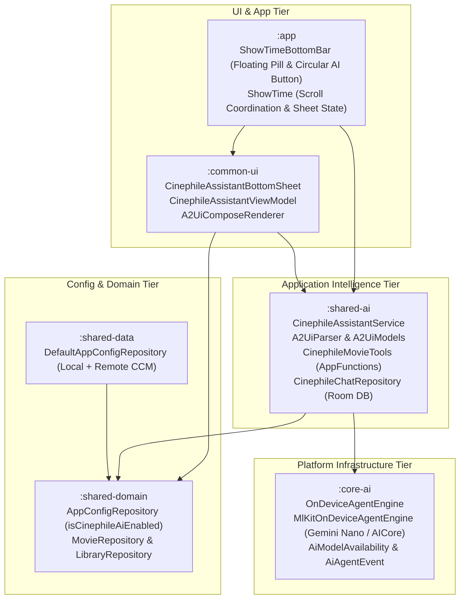
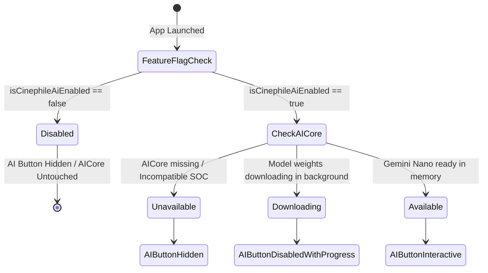
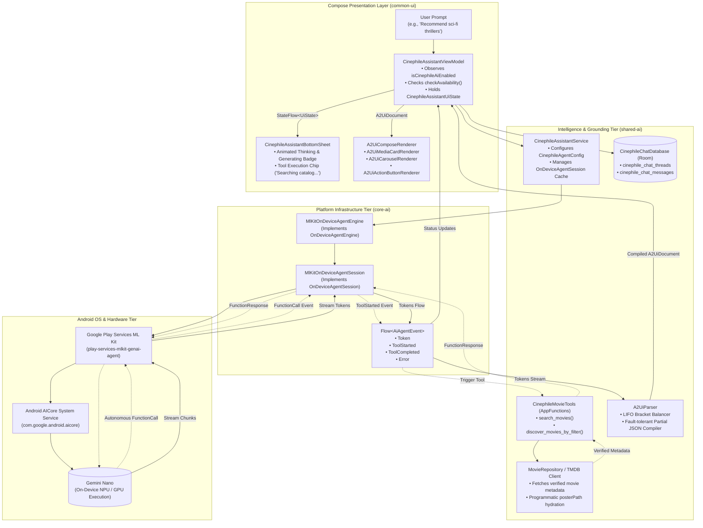
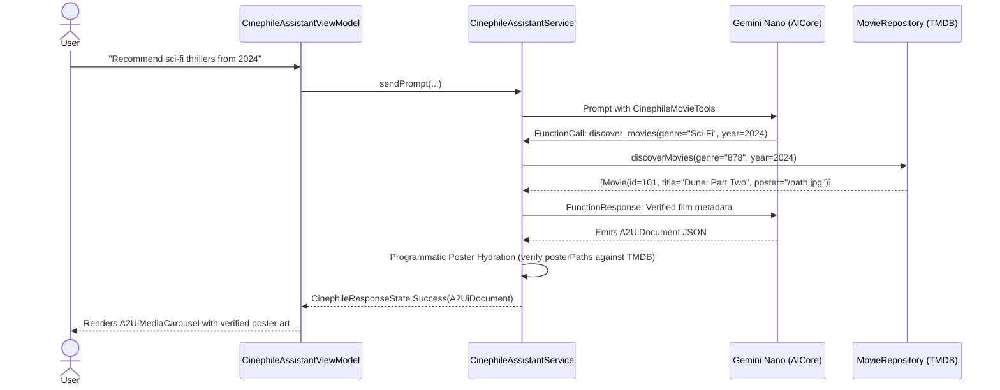

# Cinephile AI & Dynamic Agent-to-UI (A2UI) Architecture

## 1. Executive Summary & Capabilities

**Cinephile AI** is ShowTime's native on-device film concierge, built on top of **Google Gemini Nano** via the **ML Kit GenAI Agent API**. It allows users to discover movies, explore complex cinema vibes, query directors and eras, and manage their watchlists entirely on-device with zero server latency, zero cloud costs, and complete privacy.

Instead of outputting plain text or static Markdown, Cinephile AI leverages **Agent-to-UI (A2UI)**: a streaming JSON protocol that compiles agent responses into rich, interactive Jetpack Compose components (interactive media carousels, rich movie cards, quick-action chips, and one-tap watchlist buttons).

### Core Capabilities Matrix

| User Query / Intent | Agent Autonomous Action | Rendered A2UI Component | User Action Affordance |
| :--- | :--- | :--- | :--- |
| *"Find me noir psychological thrillers from the 70s"* | Executes `discoverMoviesByFilter(genre="Thriller", era="1970s")` | `A2UiComponent.MediaCarousel` with canonical TMDB poster art and ratings | Tap poster to open `MovieDetailNavKey`; tap "Add to Watchlist" button |
| *"Who directed Interstellar and what else did they make?"* | Explains Christopher Nolan's style and fetches filmography | `A2UiComponent.Text` + `A2UiComponent.MediaCard` for *Oppenheimer*, *Inception* | Tap to view movie detail or explore director credits |
| *"I need something funny and uplifting for tonight"* | Resolves vibe query to comedy genre and mood chips | `A2UiComponent.ChipGroup` ("Feel Good", "Romantic Comedy", "Animation") | Tap chip to immediately send contextual follow-up prompt |
| *"Add The Dark Knight to my watchlist"* | Emits direct `A2UiAction.AddWatchlist` | Interactive action button indicating added status | Directly saves to `LibraryRepository` locally |
| *Multi-turn conversation with topic pivot* | Taps "+ New Chat" in assistant header | Session memory resets; previous conversation saved to Room database | Thread preserved in "Past Conversations" dropdown |

---

## 2. Multi-Tier Modular Architecture

The architecture strictly adheres to ShowTime's [Modular Architecture & Capability Taxonomy](../MODULAR_ARCHITECTURE_AND_CAPABILITY_TAXONOMY.md):



### Module Responsibilities:

1. **`:core-ai` (Platform Infrastructure Tier)**:
   - Low-level wrapper around `com.google.android.gms:play-services-mlkit-genai-agent`.
   - Domain-agnostic contracts: `OnDeviceAgentEngine`, `OnDeviceAgentSession`, `AiModelAvailability`, `AiAgentEvent`.
   - Zero dependencies on TMDB, movie models, or UI code.
2. **`:shared-ai` (Application Intelligence & Grounding Tier)**:
   - Houses the Cinephile persona instructions, tool definitions (`CinephileMovieTools`), and streaming JSON parser (`A2UiParser`).
   - TMDB Catalog Grounding: query-to-filter mapping and poster URL verification to prevent hallucinations.
   - Local Room persistence: `CinephileChatDatabase` storing threads and messages.
3. **`:common-ui` (Stateful Dynamic UI Composite Tier)**:
   - `CinephileAssistantBottomSheet`: Smooth slide-up sheet with Gemini pill input, thinking animations, and history menu.
   - `CinephileAssistantViewModel`: State coordination, thread switching, and feature-flag gating.
   - Component Renderers: `A2UiMediaCardRenderer`, `A2UiCarouselRenderer`, `A2UiChipGroupRenderer`, `A2UiActionButtonRenderer`.
4. **`:app` (Entry Point & UX Coordination)**:
   - Hosts the Google Photos-style floating bottom bar (`ShowTimeBottomBar`).
   - Connects navigation routes (`MovieDetailNavKey`, `TvShowDetailNavKey`).

---

## 3. Core AI Engine & AICore Lifecycle (`core-ai`)

The on-device model runs entirely through Google's Android AICore system service. `MlKitOnDeviceAgentEngine` manages model readiness and execution:



### Core AI Runtime Interaction Architecture

The diagram below illustrates the complete end-to-end runtime interaction loop between the user, UI layer, intelligence service, autonomous AppFunctions tools, platform engine, and on-device Gemini Nano execution in AICore:



### Event Streaming Architecture:
`OnDeviceAgentSession.sendStreamingPrompt()` returns `Flow<AiAgentEvent>`:
- `AiAgentEvent.Token(text)`: Incremental output chunk from Gemini Nano.
- `AiAgentEvent.ToolStarted(toolName)`: Emitted when the agent invokes an autonomous tool (e.g., `search_movies`). The UI displays an animated pulsing badge ("Searching movie catalog...").
- `AiAgentEvent.ToolCompleted(toolName)`: Emitted when the tool returns data to the model.
- `AiAgentEvent.Error(message, isRecoverable)`: Emitted if runtime context bounds are exceeded or hardware throttling occurs.

---

## 4. Dynamic Agent-to-UI (A2UI) Protocol & Tolerant Parser

Rather than forcing the model to format tables or markdown links, Cinephile AI instructs Gemini Nano to output an ````a2ui ... ```` code fence wrapping valid JSON components.

### Component Hierarchy:
- **`A2UiDocument`**: Root document containing a list of `A2UiComponent`s.
- **`A2UiComponent.Text`**: Rendered text paragraph with typography and color styling.
- **`A2UiComponent.MediaCard`**: Single film card with poster, year, rating, and overview.
- **`A2UiComponent.MediaCarousel`**: Horizontal scrollable row of film cards.
- **`A2UiComponent.ChipGroup`**: Horizontal flow of suggested prompt chips.
- **`A2UiComponent.ActionButton`**: Contextual action (e.g. "Add to Watchlist").

### Fault-Tolerant LIFO Bracket Balancing:
During streaming, Gemini Nano generates partial JSON. Standard JSON parsers (Moshi, Gson, Jackson) throw exceptions on incomplete tokens.

`A2UiParser` incorporates a custom LIFO syntax stack parser:
1. Tracks open `{`, `}`, `[`, `]`, and string quotes.
2. Closes unclosed quotes and appends missing closing braces/brackets to synthesize a structurally valid JSON string at every partial emission.
3. Automatically strips preamble conversational text preceding the ````a2ui` block and trailing thought signatures.

---

## 5. Catalog Grounding & Hallucination Defense

Large Language Models frequently hallucinate release dates, cast members, and poster URLs. Cinephile AI implements a **Two-Tier Defense**:



1. **Tool Grounding (`CinephileMovieTools`)**:
   - The model calls `search_movies` and `discover_movies` via Google ML Kit AppFunctions annotations.
   - It cannot invent fake IDs or fake titles because it must query the verified TMDB catalog.
2. **Programmatic Poster Hydration (`enrichDocumentWithPosters`)**:
   - If the model emits an empty `posterPath` or hallucinated URL, `CinephileAssistantService` performs a fast lookup in the TMDB database by `mediaId` or normalized `title`, injecting the verified `/cdn-path.jpg`.

---

## 6. Multi-Turn Conversation & Room Persistence

Conversations are persisted locally using SQLite via Android Room in `cinephile_ai_chat.db`.

### Database Schema:
- **`cinephile_chat_threads`**:
  - `id` (String UUID, Primary Key)
  - `title` (String, derived from first prompt)
  - `created_at` (Long epoch millis)
  - `updated_at` (Long epoch millis)
- **`cinephile_chat_messages`**:
  - `id` (String UUID, Primary Key)
  - `thread_id` (String, Foreign Key with `CASCADE` delete)
  - `sender` (String: `USER` or `ASSISTANT`)
  - `text` (String message content)
  - `a2ui_json` (String nullable, serialized `A2UiDocument`)
  - `timestamp` (Long epoch millis)

### Session Context Isolation:
When the user taps "+ New Chat":
1. The active `threadId` in `CinephileAssistantViewModel` is cleared.
2. A new `OnDeviceAgentSession` is allocated in `CinephileAssistantService`.
3. Gemini Nano starts with a clean memory buffer, eliminating prompt pollution from earlier disparate topics.

---

## 7. Remote Kill-Switch & Feature Flag Gating

ShowTime enforces complete remote configuration control via `AppConfigRepository`:

- **Remote Config Key**: `cinephile_ai_enabled` (Boolean, default `true`).
- **DataStore Key**: `cinephile_ai_enabled`.
- **Implementation**:
  ```kotlin
  override val isCinephileAiEnabled: Flow<Boolean>
      get() = combine(
          keyValueStorage.observe(CinephileAiEnabledKey, true),
          appConfigProvider.observeBoolean(KEY_CINEPHILE_AI_ENABLED, true)
      ) { local, remote -> local && remote }
  ```

### Critical Zero-Footprint Guarantee:
If `isCinephileAiEnabled` evaluates to `false`:
1. `CinephileAssistantViewModel` **never calls `assistantService.checkAvailability()`**.
2. **Gemini Nano / AICore is NEVER initialized, loaded into RAM, or queried**.
3. In `ShowTimeBottomBar`, the floating circular AI button is omitted, and the main navigation pill expands to fill the bottom bar space smoothly without layout jitter.

---

## 8. UX Design: Floating Navigation Entry Point

The entry point is inspired by the modern **Google Photos / M3 Expressive Floating Bar**:

1. **Floating Pill + Detached AI Action Button**:
   - The navigation destinations sit inside an elevated capsule pill.
   - Detached 10dp to the right is a 56dp circular action button (`Icons.Rounded.AutoAwesome`) providing high-visibility access to Cinephile AI.
2. **Zero Text Truncation Guarantee**:
   - Inactive tabs show icons only (`weight = 1.0f`).
   - The active tab smoothly expands (`weight = 1.6f`) revealing Icon + Label with animated text fade-in.
   - This eliminates text clipping ("Libr", "Ho") on small screens while retaining a compact footprint.
3. **Scroll-Aware Slide Animations**:
   - Connected via `NestedScrollConnection` in `ShowTime.kt`.
   - Scrolling down slides both the navigation pill and the AI button off-screen.
   - Scrolling up reveals them immediately.

---

## 9. Verification & Quality Assurance

The Cinephile AI subsystem is rigorously tested across all architectural layers:

| Test Suite | Location | Verification Focus | Status |
| :--- | :--- | :--- | :--- |
| `A2UiParserTest` | `:shared-ai` | Streaming JSON bracket balancing, chunk completion, malformed recovery | Passed (4/4) |
| `CinephileAssistantServiceTest` | `:shared-ai` | TMDB grounding, poster hydration, session management | Passed (3/3) |
| `CinephileChatRepositoryTest` | `:shared-ai` | Room DB entity mapping, cascading thread deletes | Passed (2/2) |
| `CinephileAssistantViewModelTest` | `:common-ui` | Remote feature flag gating, AICore availability checks, thread switching | Passed (5/5) |
| Device Verification | Physical Device | Deployed and verified end-to-end on Android device running AICore | Verified |
